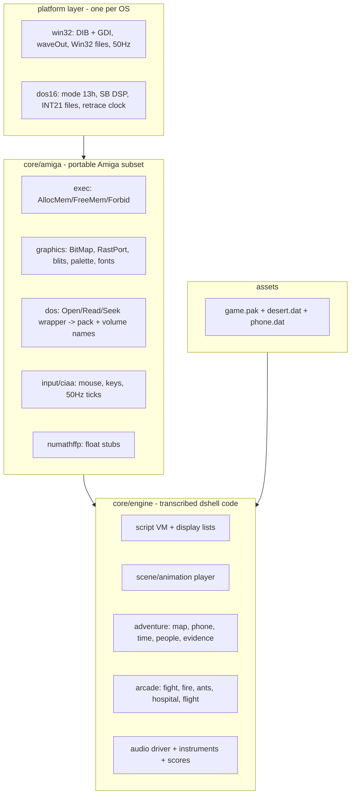

# ICFTD recompilation plan — Windows first, then DOS 16-bit

**Scope agreed 2026-11-09:** Win32 builds are fine (no native x64 needed). **Sound and
music are postponed** until the game logic runs. **Only Windows is built until it is
finished**; the DOS 16-bit target stays in the tree (it still compiles) but is not
worked on.

Status: milestone **M1 is done** — `game.pak` is built and every picture is verified.
The plan is based on the decompilation in `re/` (752 functions, 0x21A58 bytes of code)
and on toolchain tests done on 2026-11-09.

```
disks\*.adf ─► export/disks ─► export/code/dshell.img ─► re/   (done)
                                                            │
                                        assets ─► game.pak ──┤
                                                            ▼
                       core (transcribed engine + Amiga subset) ─► plat/win32  icftd.exe
                                                                └► plat/dos    icftd.exe
```

---

## 1. What is already proven

| item | result |
|---|---|
| `src\game\build.ps1` | builds both targets with one command |
| Windows target | `bin\win32\icftd.exe`, 42 KB, PE machine `0x014C` — runs; demo and picture browser tested |
| DOS target | `bin\dos\icftd.exe`, 28 KB, `MZ` real-mode EXE (still compiles, on hold) |
| shared core | `types.h`, `platform.h`, `gfx.c`, `pack.c`, `main.c` compile unchanged for both targets |

The core never includes an OS header; everything platform specific is behind
`core/platform.h`.

---

## 2. Toolchain reality check (verified, not assumed)

Open Watcom 2.0 beta (build 2026-11-08) from `H:\Meine Programme\Open Watcom`:

* `wcc386` banner: *"Open Watcom C x86 **32-bit** Optimizing Compiler … (64-bit)"* — the
  parenthesised 64-bit is the **host** binary. There is **no x86-64 code generator**:
  `binnt64` contains no `wcc64`/amd64 backend, and `-bt=nt64` produces no image.
* The **linker does** accept 64-bit COFF and emits 64-bit PE (release notes: *"added
  support for 64-bit COFF objects and 64-bit PE executable"*), so a hybrid
  clang→COFF→wlink path exists but has no 64-bit C runtime to link against.
* 16-bit DOS real mode works (`wcl -bt=dos -ml`), Win32 works (`wcl386 -bt=nt`).
* Paths with spaces break the Watcom tools (they re-parse the command line; 8.3 short
  names are disabled on this machine) — `build.ps1` quotes every path.
* `INCLUDE`/`LIB`/`WATCOM` must be set; the build script does it, do not rely on the shell.

### Decision on "Windows 64-bit"

| option | consequence |
|---|---|
| **A. Win32 PE built with Open Watcom** (recommended, done) | runs natively on 64-bit Windows through WoW64; one compiler for both targets; no 4 GB limits that matter for a 320×200 game |
| B. Native x64 with clang-cl / MSVC / LLVM-mingw | needs a second toolchain; core must be 64-bit clean (no `int`-as-pointer, `size_t` everywhere) |
| C. clang x64 COFF + `wlink` | experimental; OW ships no 64-bit libc, so only freestanding code links |

Plan: build A now and keep the core **64-bit clean** (rules in §9), so switching to B is a
one-day job later. If a *native* 64-bit binary is a hard requirement, B is the only path —
it cannot be done with Open Watcom's C compiler.

---

## 3. What the decompiled program actually is

### 3.1 Code layout (`re/disasm/dshell.asm`, `re/decomp_all/dshell/`)

| range | content |
|---|---|
| `0x000000`–`0x000300` | entry stub + 45 tiny records (`0x6`–`0xDF`), colour-ish table, direction strings from `0x99` |
| `0x000300`–`0x1E7FF` | **game + engine** (≈124 KB, the part to port) |
| `0x1E800`–`0x21A58` | Amiga OS/startup glue: `OpenLibrary` calls, clib wrappers, allocator, exit |
| data `0x21A58`–`0x26820` | 19,912 B: **160 × 6-byte `jmp` stubs** (`0x21A58`–`0x21E14`, the engine's vector table; 158 targets are function entries), constants (`0x21E18`–`0x21E96`), 45 pointers at `0x21E96` to the records at `0x6`–`0xDF`, then 411 code pointers spread over the hunk plus strings and data |
| data `0x26820`–`0x2D594` | zeroed BSS (loader allocation), all globals are `(offset,A4)` with **A4 = 0x29A56** |

`0x1E800`–`0x21A58` is **obsolete in the port**: it is exactly what the platform layer and a
small Amiga-API subset replace.

### 3.2 External dependencies the port must provide (from the strings)

| dependency | used for | port answer |
|---|---|---|
| `dos.library` | open/read/close, disk-swap prompts (`Please insert disk: REEL %d`) | pack streaming + file API |
| `graphics.library` | bitmaps, rastports, blitter ops, palette | software blit layer (§4.3) |
| `intuition.library`, `layers.library` | screen/window, mouse pointer, `BltBitMap` | own screen + sprite pointer |
| `diskfont.library` | font `6TOnewnem.font` | font converted to 8×N bitmap in the pack |
| `icon.library` | disk-insert dialog icons | not needed (no floppy swapping) |
| `input.device`, `ciaa.resource` | mouse/keyboard events, timers | platform input + 50 Hz tick |
| `Numathffp.library` | floating point | string at `0x21A0A`, **no direct code reference found** — verify in M3, may be dead or reached through the stub table; use `float`/`double` (Win32) and fixed point (386 DOS) if it is live |

Direct hardware writes are rare and all in the sound driver: `0xDFF0A0` (AUD0 base) and
`0xDFF096` (DMACON) — i.e. **the music plays through Paula registers written by game code**,
not through `audio.device`. That shapes the audio plan (§6).

### 3.3 Game data on the disks

| volume | files | notes |
|---|---|---|
| `Desert1:` | `dshell`, `OPEN`, `UNDER`, `ANI`, `INSTS`, `SCORES`, `HDesert`, `HD_INSTALL` | `OPEN` = 70 entries (5 `MovE` scripts, 65 `SMS` pictures) |
| `Desert2:` | `BACKS` (388 KB), `PEOPLE`, `desert.dat` (125 KB), `phone.dat`, `rs` | `rs` is IFF `FORM…8SVX` (8-bit sample) |
| `Desert3:` | `BACKS1`, `BIGANT`, `CHICK`, `FIGHT`, `FIRE`, `HOSP` | the arcade sequences |
| `DES4:` | `ANI`, `INSTS`, `SCORES` referenced with this prefix | **open question**: the shipped disks are labelled `Desert1..3`; the loader must accept both names |

`INSTS` = 35 instrument files (`.rff`, `.ss`, `.synth`), `SCORES` = 17 `.tiny` scores
(`MAINTITLE`, `MAP`, `FIGHT`, `HOSPITAL`, `ELMER`, …) → a **custom software synthesiser**, not
MOD playback. `sfx/…` paths appear in strings but no such files exist on the disks; the
`sfx` directory in the image is empty (they are probably generated cached samples — resolve in M6).

### 3.4 Subsystem anchors (address → role, verified by string cross-reference)

| function | size | role |
|---|---|---|
| `FUN_000002f4` | 468 B | file open + "insert disk / REEL %d" loop — the loader |
| `FUN_0000247a` | 1684 B | the action menu: *Fight, Fire Game, Make a Call, Escape Hospital, Situation Map, Take a Flight* |
| `FUN_00003b1e` | 1520 B | location services, opening hours, "has been destroyed" |
| `FUN_00003706` | — | travel / `ETA: %02d:%02d` |
| `FUN_000043b8`, `0x451a` | | intro/`DES4:` sequences |
| `FUN_0000a74e` | — | `FightBack` (boxing sequence) |
| `FUN_00009b60`–`0x9c40` | | writes Paula `AUD0` registers — sound driver |
| `FUN_00009870` | 156 B | sound/scene init that calls through the handler table with string args |
| `FUN_0001e7e0` | — | opens `graphics`/`intuition`/`layers` (OS glue) |
| `FUN_0001ec42` | 1020 B | clib/allocator glue (OS) |
| `0x21A58`..`0x21E18` | 160 × 6 B | `jmp <code>` stubs = the engine's own vector table; every indirect engine call goes through a slot here |
| `0x21E96` | 45 × 4 B | pointers to the 45 records at `0x6`–`0xDF` (record starts, not functions) |
| `0x21F4A`+ | 411 × 4 B | further code pointers in 128 short runs, interleaved with data |

---

## 4. Architecture

### 4.1 Layers



### 4.2 Why an Amiga-API subset instead of a fresh engine

The decompiled code is 1409 library calls plus ~750 functions of game logic. Two ways to
reuse it:

* **(chosen)** transcribe the game code *as it is* and implement the ~40 Amiga functions it
  calls in portable C (`core/amiga/`). The transcribed code keeps its shape, so it can be
  verified function by function against the disassembly and the behaviour of the original.
  The Amiga layer is a one-time cost of a few thousand lines and is fully testable.
* rejected: reverse-engineer the design and write a new engine — doubles the risk, makes
  behavioural comparison impossible, and throws away validated logic.

Consequence: **globals keep their layout.** The 19,912-byte data hunk becomes
`u8 g_data[]` at the same offsets (`A4 = g_data + 0x7FFE` conceptually, i.e. the ported code
uses `A4_8(off)`, `A4_16(off)`, `A4_32(off)` macros). Once a global's meaning is known it is
replaced by a named variable; the ledger records which ones are still raw.

### 4.3 Rendering model

* one **8-bit indexed framebuffer** 320×200 (`gfx_fb`), one palette of 256 entries
* assets are converted planar→chunky at **build** time, never at run time
* blit primitives: opaque, colour-key, clipped, tile; a `plat_present()` per tick
* the mouse pointer is a software sprite drawn on top (Amiga had a hardware sprite)
* palette fades (`FUN_00009b60` area) write the palette register model, not hardware
* copper-list effects, if the engine uses them (M2 investigation), are emulated as
  per-scanline palette/scroll entries applied when the frame is flattened — DOS cannot do
  mid-frame palette changes cheaply in mode 13h, so keep the count low or disable

### 4.4 Timing

The game logic runs at **50 Hz** (PAL Amiga frame). One core tick = one `plat_frame_sync()`.
Windows paces with `GetTickCount`; DOS paces on VGA retrace (5 ticks = 7 retraces = 100 ms).
Frame-rate independence comes *only* from the tick counter, never from wall-clock deltas, so
both platforms and future ones produce identical simulation results.

---

## 5. Project structure

```
src/
  assetExport/              existing: ADF/FS, banks, SMS, LZ, art, hunk  (datamining)
    (new) Pack.cs           builds game.pak from the extracted banks
  game/
    core/                   portable, no OS headers, C89, 32/16-bit clean
      types.h platform.h    contract (framebuffer, palette, input, clock, files, heap)
      gfx.h gfx.c           framebuffer + blits (done)
      pack.h pack.c         game.pak reader: entries, pictures (banded), palettes (done)
      assets.h assets.c     data-root lookup + first-run decode of disks\*.adf (done)
      main.c                bootstrap, tick loop, --browse/--shot/--checksum (done)
      amiga/                Amiga subset
        exec.c  exec.h      memory, lists, forbid/permit
        graphics.c .h       BitMap/RastPort, blits, palette, fonts, screens
        dos.c   dos.h       Open/Read/Close/Seek over the pack, volume names
        input.c input.h     mouse/keyboard state + 50Hz tick source
        intuition.c layers.c diskfont.c icon.c  (thin, mostly stubs)
        numathffp.c
      engine/               transcription of dshell 0x000300..0x1E7FF
        gamedata.h gamedata.c   the 19,912-byte data hunk + A4 accessors
        script.c .h         MovE bytecode VM (dispatch table 0x21C04)
        display.c .h        display lists, sprites/windows, draw order
        scene.c .h          scene loading, palettes, transitions
        adventure.c .h      desert.dat: locations, exits, time, services
        phone.c .h          phone.dat
        people.c .h         PEOPLE bank, dialogues, evidence
        saveload.c          SCORES/high scores/persistence
        game.c .h           top-level state machine, tick dispatch
        minigames/fight.c fire.c ants.c hospital.c flight.c
        audio/driver.c instruments.c mixer_paula.c
    plat/
      win32/plat_win32.c   window, DIB, palette, input, clock (done) + waveOut (M6)
      dos/plat_dos.c       mode 13h, palette, mouse, keys, retrace (done) + SB DSP (M8)
    build.ps1              both targets + asset exporter publish (done)
assets/                    game.pak, decoded on first start (build output, not in git)
docs/
  recomp-plan.md           this file
  port-ledger.csv          752 rows: addr,size,params,name,module,status,notes
tools/
  start.ps1                build what is missing, then start (the usual entry point)
  extract.ps1              disks -> export/disks + export/code/dshell
  gamepack.ps1             disks -> assets/game.pak (wraps the exporter's gamepack)
  verify-pack.ps1          pack reader vs exporter pixel comparison (547 pictures)
  show-picture.ps1         render one pack picture to PNG
  ghidra/                  decompilation pipeline (run-ghidra.ps1 + scripts/)
```

---

## 6. Asset pipeline

### 6.1 Pack format v1 (`assets/game.pak`)

```
"ICFP" u16 version u16 count u32 data_offset
entries[count] (16 bytes, little endian):
   u32 name_hash   u32 offset   u32 size   u8 type   u8 flags   u16 aux
type: 1 picture(chunky w x h)  2 palette(768 B)  3 script(MovE raw)
      4 raw logic data         5 sample(8-bit signed mono)  6 font  7 music
```
`name_hash` = FNV-1a of the **original resource name** so the ported loader can keep asking
for `"BACKS1"`, `"Crowd3.win"`, … exactly like the Amiga code does.

Rule: **logic data stays byte-identical** (big-endian, original offsets) — `desert.dat`,
`phone.dat`, `MovE` scripts, `.tiny` scores, instruments. Only *pixels* (planar→chunky),
palettes (12-bit→8-bit) and samples (8SVX→raw) are converted. Reason: the ported readers are
transcriptions of the original readers; converting logic data would create a second, unverifiable
format.

### 6.2 Palette strategy

**No colour reduction.** Amiga pictures use 4–6 bitplanes (16–64 colours) and every picture
keeps its own palette (deduplicated, type-2 entry) with 8-bit indices. 256 entries are far
more than any single Amiga screen, so the port is colour-exact:

* one palette is active at a time, exactly like the Amiga (the engine fades it in/out);
* when a scene and a sprite bank must share the screen, their two palettes are merged at
  build time into one ≤256-entry palette (plus a per-bitmap index remap) — not at run time;
* VGA mode 13h and the Windows framebuffer are both 8-bit, so the same picture data is used
  by every target.

Resolution also matches: Amiga scenes are 320x200, VGA is 320x200. Only two assets are larger
(608x216 tile map `UNDER/tilz.pic`, 640x400 map `ANI/MMAP`); the reader serves them in row
bands and the screen shows the visible window, no scaling or cropping of normal scenes.

Do **not** use `DosPlanar`/`.pl4`/`*.dos.png`: that is the old 16-colour planar path of the
*original MS-DOS build* (EGA-style renderer), kept only behind `export ... --dos` for that
earlier investigation. It is lossy and has nothing to do with this port.

### 6.3 Fonts

`6TOnewnem.font` (Amiga font file) → 8×N bitmap strip in the pack; `diskfont` shim exposes
`OpenFont`/`Text`/`TextLength` exactly as the engine expects.

### 6.4 Sound

`rs` (IFF 8SVX) and any sample payloads → type 5 entries, signed 8-bit mono at the Amiga
rate; `INSTS` instruments and `SCORES` music stay raw for the ported driver (§7 M6).

---

## 7. Milestones

Each milestone ends with a **demo you can run** and a **written acceptance test**.

### M0 — toolchain + skeleton ✅ done
Both executables build from one source tree; Windows window runs at 50 Hz.

### M1 — asset pipeline + picture browser ✅ done (2026-11-09)
* `src/assetExport/Pack.cs` + `gamepack` command: all 13 banks decoded into
  `assets/game.pak` — 793 entries (547 pictures, 75 palettes, 107 `MovE` scripts, 64 raw),
  4,840 KB. Names are `<volume>/<bank>/<resource>` so the loader keeps Amiga semantics.
* `core/pack.c/.h` (reader, banded row reads for pictures bigger than the screen) and
  `core/platform.h` file + heap API, implemented for Win32 and DOS.
* `icftd.exe --browse [pack]` steps through every picture; `--shot` renders one to BMP
  (`tools\show-picture.ps1` turns it into PNG); `--checksum` feeds the verifier.
* **Accept:** `tools\verify-pack.ps1` → **547 pictures verified, 0 mismatches, 0 missing**:
  every picture read from the pack hashes identically to the `.idx8` the exporter decoded
  straight from the ADFs.
* Two pictures exceed the 320x200 framebuffer (a 608x216 tile map and the 640x400 map
  screen); they are read in row bands instead of a 256 KB buffer — the same code will work
  in 16-bit DOS.

### M2 — video parity + original screen geometry (in progress)
**Step 1 — what the original does ✅ done (2026-11-09)** → `docs/graphics-notes.md`
* Every OS call is now named correctly: `tools\analyse-os-calls.ps1` resolves the library base
  A6 holds in each wrapper and looks the offset up in *that* library's table (LVO order from
  the AROS `.conf` lists, cross-checked against `Text = -60`, `OwnBlitter = -456`,
  `dos.Read = -42`, `AllocMem/FreeMem = -198/-210`, `OpenLibrary = -552`).
  Output: `docs\os-calls.csv`, `docs\engine-slots.csv` (slot → OS name + call count).
* Screen: **320×200** (`RectFill(rp,0,0,0x13F,0xC7)` at `0x7E8`), depth `min(src Depth,5)`,
  built as its own View/ViewPort/RasInfo/ColorMap + generated copper list
  (`FUN_0001FAEC`: InitView/InitVPort/InitBitMap/GetColorMap/MakeVPort/MrgCop/LoadView).
  **No intuition screen**, no OS pointer.
* Exactly **35 graphics calls** are used; no `LoadRGB4`/`SetRGB4` (palette goes straight into
  the ColorMap `ColorTable`), no `BltBitMapRastPort`/`BltTemplate`, but `AreaMove/AreaDraw/
  AreaEnd` with a TmpRas are used.
* **Step 2 — graphics layer ✅ done (2026-11-09)** → `src/game/core/amiga/graphics.[ch]`
  RastPort/BitMap/ColorMap over the chunky framebuffer with `RectFill`, `Move`/`Draw`,
  `AreaMove/AreaDraw/AreaEnd`, `Text`, palette upload and bit-exact blits (`agfx_minterm`,
  a pen goes through the minterm per bit, cookie-cut via `AGFX_MT_COOKIE`). Verified by
  `icftd.exe --gfx-test <out.bmp>`: bars, 32 palette swatches, 16-line fan, filled star,
  plain blit, masked blit.
* Still to do in M2:
  * **Step 3 — reference harness ✅ done (2026-11-09)**: `tools\make-winuae-config.ps1 -Rom <rom>`
    writes a fixed A500/OCS/1 MB config with the three game disks in DF0-2 (`-f tools\icftd.uae`),
    `tools\freeze-frame.ps1` grabs a window's client area to PNG (desktop copy, so DirectDraw/D3D
    sources work) and `tools\diff-frame.ps1` compares two images with an optional crop
    (`-CropB "x,y,320,200"`), printing differing pixel count, max channel delta, the difference
    box, and writing a magenta-on-dim difference image; exit code 0 = identical. Validated with
    identical renders (0 diffs), a 5x5 edit (25 diffs, correct box) and a bordered 400x260 capture
    cropped to 320x200 (0 diffs).
  * Text needs the game's real font (lives in the ART banks) — `agfx_text` takes an `agfx_font`
    and is untested until then.
  * software mouse sprite; a counter for any primitive we did not implement.
  * A WinUAE capture of the title screen and of one desert scene, then run the acceptance diff.
* **Step 4 — first reference frame ✅ done (2026-11-09)**: the user's existing WinUAE grabs have
  the game area at exactly `x 58..697, y 88..487` (640x400 = 2x pixel replication);
  `tools\ref-frame.ps1` crops and halves it to 320x200. `icftd.exe --match <ref.bmp>` ranks
  every picture by matching pixels:
  * `ref\room.bmp` (room, no narration box) → **`Desert2/BACKS/!B28`, 0 differing, 100 %**.
  * `ref\scene1.bmp` (same room with the narration box over the bottom third) → `!B28` at
    75.1 %; the rest is the box painted on top. Rows 0-109 are identical (`-Tolerance 16`).
  Maximum channel difference on matched pixels is 15, which is WinUAE's 4-bit output path, not
  our palette — always diff with `-Tolerance 16`.
* **Accept:** a still frame reconstructed from the pack is pixel-identical to a WinUAE
  screenshot of the same scene → **met** (`ref\room.bmp` vs `Desert2/BACKS/!B28`). The
  composited scene (`ref\scene1.bmp`) becomes the M3 acceptance target.

### M3 — script VM, display lists, scenes (1–2 weeks)
* Composite reference: `Desert2/BACKS/!B28` + narration box must reproduce `ref\scene1.bmp`
  exactly (M3 acceptance starts here, the diff harness is already in place).
* Keep the 160-entry stub table as an array of function pointers (`core/engine/vector.c`), so
  transcribed code that calls `stub[37]` keeps working and the slot → function mapping is
  documented once.
* Transcribe the VM that walks the 45-record table at `0x21E96` and the code pointers it
  finds; `core/engine/script.c`, `display.c`, `scene.c`.
* Port `FUN_000002f4` (open/insert-disk) semantics into `amiga/dos.c` volume resolution
  (`Desert1..3`, `DES4` alias → pack groups).
* **Accept:** the opening sequence (`OPEN` bank, scripts `!LOS`/`!OPN`/`!WIN`/`!WN2`)
  plays end-to-end, timed by the 50 Hz tick, and matches a WinUAE capture frame-by-frame
  within a tolerance of 1 frame on 5 sampled timestamps.

### M4 — adventure shell: world, map, menus, time (2–3 weeks)
* `desert.dat` model (locations, exits, opening hours, services) + `phone.dat`
* action menu `FUN_0000247a`, travel `FUN_00003706` (`ETA`), services `FUN_00003b1e`
* people/evidence (`PEOPLE`, `FUN_0000a74e` callers), status line `A:%d P:%d C:%d T:%d`
* **Accept:** the player can leave the intro, look around, walk between two locations, use
  the map and the phone, and see the status numbers change; state survives save/load.

### M5 — audio (postponed until the game runs; 1–2 weeks)
* `mixer_paula.c`: 4 channels, period→step, volume, loop, 8-bit signed; resample to the
  platform rate (22.05/44.1 kHz, 16-bit stereo out).
* Port the driver around `0x9b60..0x9c40` (register writes) and the instrument loader for
  `INSTS` (`.rff`, `.ss`, `.synth`), score player for `SCORES` (`.tiny`).
* Win32 `waveOut` backend; `plat_audio_write()` added to `platform.h`.
* **Accept:** `MAINTITLE` music plays; A/B against a WinUAE recording by ear and by
  spectrogram; fighting sounds trigger at the right moments.

### M6 — arcade sequences, one at a time (2–4 weeks)
`FIGHT` (boxing, `FUN_0000a74e`), `FIRE`, `BIGANT`/`CHICK` (ants), `HOSP` (hospital escape),
flight (`Take a Flight`, `Numathffp` user).
**Accept per sequence:** playable to win/lose, score feeds the adventure state.

### M7 — DOS 16-bit (deferred until the Windows build is finished; 1–2 weeks)
* memory: XMS (INT 2Fh/AH=43h) as asset cache, EMS fallback, reload from disk if neither;
  Sound Blaster DMA buffer allocated below 1 MB with `_fmalloc` at startup
* input: INT 9h handler for real key-down/up; INT 33h mouse
* audio: SB DSP 8-bit mono DMA (single-cycle + IRQ re-arm) or PC speaker fallback
* performance: `#pragma aux`/`-4` inline asm for `gfx_blit`, `gfx_fill`, planar→chunky of
  the mouse sprite; keep the frame under 20 ms in DOSBox with `cycles=auto`
* **Accept:** same content as the Win32 build at 50 Hz, no memory error, plays on DOSBox-X
  and on a 486 (or DOSBox with `cputype=486`).

### M8 — polish (1 week)
integer scaling/fullscreen on Windows, options (music/sfx volume, skip), high scores
(`SCORES`), credits, deterministic replay test suite in CI.

Effort estimate: **≈3–4 months** of focused work for one developer; M1–M3 alone (a running
intro) is about 3 weeks.

---

## 8. Port methodology

The ledger `docs/port-ledger.csv` (752 rows) is the working document. Every row ends in one
of: `port` (reimplemented in `core/engine`), `amiga` (replaced by `core/amiga`),
`libc` (replaced by a standard function), `obsolete` (OS glue, e.g. the whole
`0x1E800`–`0x21A58` range), `data` (jump table / string).

Transcription rules (this is what keeps the output honest and compilable):

| Ghidra artifact | replacement |
|---|---|
| `undefined1/2/4`, `uint`, `int` | `u8/u16/u32`, `u32`, `s32` (never plain `int` — 16-bit on DOS) |
| `unaff_A4` | `A4` pointer, `A4_8/16/32(off)` macros |
| `extraout_A0`, `in_stack_*`, `CONCAT22` | explicit locals with a comment citing the register |
| `DAT_0002d54a` | `A4_32(0x2D54A - 0x29A56)` until identified, then a named field |
| `_DAT_00021d64` (pointer call) | `AMIGA_CALL(slot, …)` through the handler table |
| `(**(code **)(x + 0xNN))()` | named Amiga API call once the LVO is identified |
| missing/odd control flow | re-read the disassembly; never "fix" by guessing |

Every ported function gets a header comment with the original address so the ledger and the
decompilation stay linked:

```c
/* dshell:0x00a74e  boxing sequence - called from the action menu */
void fight_sequence(void);
```

A **semi-automatic transpiler** (`tools/portgen/`) is planned for M3: it rewrites
`re/decomp_all/dshell/functions/*.c` with the table above, using a JSON symbol map
(address → name/kind), and emits `core/engine/*.c` skeletons that a human then reviews.
Even at 70 % mechanical accuracy it removes most of the typing and the type mistakes.

**64-bit cleanliness** (so option B in §2 stays open): no casts between pointers and `int`,
`size_t` for sizes, no assumptions about pointer size, no packed structs without `#pragma pack`.

---

## 9. Testing and validation

| level | method |
|---|---|
| asset decoders | bit-compare against the PNG/idx8 output already produced by `ICFTD.AmigaExport` |
| Amiga subset | unit tests (`tools/tests/`): blit edge cases, palette fade, allocator, pack reader |
| script VM | feed every `MovE` script from every bank, assert no unknown opcode, deterministic state dump |
| game logic | deterministic replay: fixed 50 Hz ticks + scripted input → hash of framebuffer + game state per tick |
| visual parity | WinUAE captures at fixed timestamps (title, first scene, one minigame) vs our frames |
| audio parity | WinUAE recording vs rendered music, spectrogram comparison + spot listening |
| DOS | DOSBox-X with `xms/ems on/off`, `cputype=386/486`; the DOS build has no floating point requirement |

The **DOS original** (already analysed in earlier sessions) is a second reference for game
*rules* (menus, scores, timings) though not for pixels.

---

## 10. Risks

| risk | impact | mitigation |
|---|---|---|
| audio synthesiser (`.tiny`/`.rff`/`.ss`) is undocumented | music may not sound right | port the driver verbatim from `0x9b60..0x9c80` + instrument loader; offline renderer tool first (render scores to WAV) to validate the mixer without the game |
| `Numathffp` use unknown | one subsystem (likely flight) may need FP | locate call sites in M3; use `double` on Win32, fixed point on 386 DOS |
| record table / stub table opaque | script VM start-up blocked | stub table is mapped (`docs/vector-table.csv`); decode the 45 records at `0x6`–`0xDF` and their 15-record size pattern with a small disassembler tool in M3 |
| DOS memory (388 KB banks) | cannot hold a reel in 640 KB | XMS cache + streaming; the original already streams per reel |
| DOS audio DMA > 1 MB | Sound Blaster silence | allocate the DMA buffer once at start-up with `_fmalloc`, never reallocate |
| OW has no x64 codegen | "64-bit" requirement | Win32 now (runs on Win64), optional clang-cl build for a native x64 image |
| 752 functions to port | schedule risk | ledger + transpiler + milestone slices; OS glue (~0x1E800+) is deleted, not ported |

---

## 12. Handoff (2026-11-09)

M0, M1 and M2 are done and verified; **M3 is under way: the intro logo frame is
reproduced**.

* Nothing is in flight: `src\game\build.ps1 -Target win32` (and `-Target dos`),
  `tools\verify-pack.ps1` → 547 pictures / 0 mismatches, `tools\verify-scene.ps1` →
  `room` 0, `scene` 0 and `logo` 26/64000 differing pixels at tolerance 16.
* **There is no overlay.** The whole game is in the dshell hunk: no register-indirect jump
  exists anywhere, and `BltBitMap` is never called — `FUN_0001E8C8` programs the blitter
  registers itself (`BLTCON0 = shift<<12 | USEA/USEB/USEC/USED | 0xCA`, channel A = 1-bit
  cookie-cut mask, destination bottom-up with negative modulos). `MovE` scripts are data
  (tag, name table, label table, body) and cannot carry code.
* `core/amiga/blitter.[ch]` ports that routine. `icftd.exe --scene <pack> <backdrop|->
  <sprite> <x> <y> <key> <out.bmp> [palette]` drives it, and
  `icftd.exe --compose <pack> <out.bmp> <palette|-> name,x,y,key ...` draws a whole list
  of objects over a cleared screen.
* **SMS pictures are decoded exactly**, not heuristically: `src/assetExport/Sms.cs` is a
  port of `FUN_0001EC42` (descriptor + optional 128-byte palette) and `FUN_0002011A`
  (the RLE walk). The pieces that were previously guessed wrong:  * the data starts at `+26`, or at `+154` when `word(+24) & 0xFF00 != 0` (the palette is
    exactly 128 bytes: 32 colours × 3 bytes, components in the high nibbles);
  * `RowBytes(w) = ((w + (w&7 ? 8 : 0) + ((w&0x800) ? 8 : 0)) >> 3)` — ceil(w/8), *not*
    16-bit aligned (this differs for w = 132, 17, 7, 114, …);
  * `+20` holds one nibble per plane (LSB first): 8/0xC = plane not stored, all zeros;
    0xD = not stored, all ones; anything else = stored, and the bit position is the
    declared plane index, so only `stored` planes are in the stream;
  * the stream is walked column by column with stride `RowBytes`, in one of two orders
    selected by the low byte of the palette flag — `(column, plane, row)` when it is 0,
    `(plane, column, row)` otherwise.
  With that, `Lgo4` (132×5) turns out to be the **"PRESENTS"** line, `Lgo1` the
  CINEMAWARE word and `Lgo2` the (R) mark; `Lgo3` (190×17) is the same word as an outline.
* `ref\logo.bmp` is reproduced by `--compose` of `Lgo1` (39,46), `Lgo2` (273,90) and
  `Lgo4` (92,99) with `LogoFlash.pal`: **26 of 64000 pixels differ**, all inside the 7×8
  (R) mark. Note the **+2**: the intro renders objects two lines below the script's y,
  which is not yet traced to an instruction in the render path.
* The MovE opcodes are decoded (`FUN_0001F89C`); see §4 of `icftd-original`-style notes in
  the repo memory: 1 draw, 2/3 delete, 8 wait, 0xC set palette, 0xD fade palette,
  0x10 set the object's blit mask, 0x11 set its frame, 0x17 fill the palette with one
  colour, 0x18 the same for the second palette, 0x19 swap entries, 0x1A set one entry.
* **The intro runs**: `core/move.[ch]` ports the display-list engine (`FUN_0001FA02` walk,
  `FUN_0001F95C` command step, `FUN_0001DBD0` blit, the four palette arrays and the fade in
  `FUN_0001D8F4`/`FUN_0001D96E`). `icftd.exe --intro <pack> <script> <label> <from> <to>
  <prefix>` runs a label and writes one BMP per frame; `MV_TRACE=1` prints every command.
  `Desert1/OPEN/!OPN` `Logo` reproduces the sequence: 20 frames black, the three objects,
  a 40-frame fade to `LogoD` (the word appears because `LogoD` is lit at 9..16 and the
  objects are drawn with channel 3 forced to 1), the instant `LogoFlash`, the masks
  flipping to channel 3 = 0, `Flash2` flying right, then the fade to `LogoL`.
  The bit-plane selector is what makes the "shimmer": command 0x10 sets a 32-bit mask
  whose nibbles feed the blitter per destination plane (< 8 = source plane, 8 = leave the
  destination, > 8 = force 0/1).
* **Exporter fix**: `.pal` records are 32 colours of 3 bytes after the 26-byte header
  (`FUN_0001D87C` converts exactly 0x20). `PaletteOf` used to copy the whole record tail,
  which dragged in the record's pixel data and the neighbouring record — `LogoD.Pal` came
  out with a stray copy of `LogoFlash`'s colours and 43 entries.
* **Hot spots**: `FUN_0001DBD0` places an object at `pos - hotspot`, hotspot = the record's
  header words at +12/+14 (`Flash2.win` has (44,44), the centre of its 45x45 patch). The
  pack's picture payload grew from 8 to 12 bytes to carry them, and `move.c` uses them.
  Without this the flash swept *below* the word instead of across it.
* **Draw order**: `FUN_0001DCB0` inserts a new object into the child list **sorted by a
  priority word** (the high half of a command's third argument); equal priorities keep
  creation order. The renderer walks that order, so a later/higher-priority object
  composites on top. `move.c` appended in creation order before this was understood, which
  left the flash *under* the logo.
* The shimmer itself is `Flash2.win`: created at (0,89) with velocity (+5,0) and channel
  selector `0x8888D888` - planes 0..2 are left alone and plane 3 is forced to 1, so it
  draws no pixels of its own; it brightens whatever is underneath inside its 45x45 window.
  `LogoFlash.pal`'s colours 8..15 are the pale variant of 0..7, so the word lights up as
  the window sweeps across it.
* The narration box is driven by `FUN_00005EAC(scene, mode)`: anchor y 245 → 155 in
  accelerating steps (open) / 155 → 275 (close), position `(160.0, y)` on a 16.16 grid,
  screen position `(160 - hotspotX, y - hotspotY)` with the record's hot spot at +12/+14.
* Reference capture is automated (see `tools\`): `make-winuae-config.ps1` (stock A500:
  512 KB chip + 512 KB slow — the memory layout is what makes WinUAE render correctly),
  `winuae-capture.ps1` (run through a VS Code task), `capture-analyse.ps1`, `ref-frame.ps1`.
  `ref\logo.bmp`, `ref\desert1.bmp`, `ref\desert2.bmp` hold the intro.
* **Next**: the MovE runtime — find the object render path (the +2 offset and the 0xCA
  minterm call), then run the `Logo` label end to end and reproduce the shine, the
  sparkle and the `LogoD → LogoFlash → LogoL` fade, then the desert parallax.
* Keep `docs/os-calls.csv` / `docs/engine-slots.csv` in sync (`tools\analyse-os-calls.ps1`)
  and add new `core` sources to `src/game/build.ps1`'s `$srcsCore` list.

---

## 11. Tools that would help (please install in this order)

| tool | installed | why | needed by |
|---|---|---|---|
| **Open Watcom 2.0** | `H:\Meine Programme\Open Watcom` | both targets | M0 |
| **Ghidra 12.2** | `H:\Meine Programme\Ghidra` | decompilation | done |
| **ripgrep** | `H:\Meine Programme\ripgrep` | searching 752 decompiled files and the 5 MB listing | now |
| **WinUAE** | `E:\Meine Programme\WinUAE` (ROMs in `C:\Users\Public\Documents\Amiga Files\WinUAE`, use `KICK13.ROM`) | reference captures: frames, music, timings | M2 (done) |
| **DOSBox-X** | present (used for the DOS project) | run and debug the 16-bit build | M7 |
| **SoX** or Audacity | not yet | compare rendered music/sfx against WinUAE recordings | M5 |
| **LLVM/Clang** | not needed | native x64 build — dropped, Win32 is acceptable | — |

---

## 12. Next sprint (M2)

1. Read `FUN_0001e7e0` (opens graphics/intuition/layers) and the screen setup it feeds;
   write `docs/graphics-notes.md` with the exact mode, bitplane count, copper usage and
   palette handling of the original.
2. Port the graphics functions the engine actually calls into `core/amiga/graphics.c`
   (`BltBitMap`, `BltBitMapRastPort`, `SetAPen`, `RectFill`, `Text`, `SetRGB4`, `ScrollRaster`,
   …) on top of the chunky framebuffer and `gfx.c`; keep a counter of unimplemented LVOs so
   nothing is silently skipped.
3. Implement the software mouse sprite and a first `core/amiga/exec.c` allocator.
4. Capture the WinUAE title screen and the first desert scene, and add them to a
   `reference/` diff harness (frame hash + visual diff).
5. Then start M3: decode the 45 records at `0x6..0xDF` (45 pointers at `0x21E96`) and their
   repeating 15-record structure, then port the first script opcodes.

---

## 13. Legal / packaging

The game data is copyrighted and stays outside the repository, exactly as today: `disks/`
and `assets/` are inputs, `game.pak` is built locally, and no extracted art, music or text is
committed. A release is a folder with the exe plus a generated pack, produced by the user
from their own disks.

---

## 14. Scaling up: framework, tooling and sweeps

**Read [`docs/scaling-plan.md`](scaling-plan.md).** It is the executable version of this
section: the end goal (a reusable engine library plus sweeps of 20–50 original functions per
session), the three pillars that make that possible, the tooling to build, the subsystem
sweep order with exit criteria, the metrics to steer by and the risks.

Short version, because it changes how this project must be worked:

* The asset pipeline is done and provably correct. The bottleneck is now **the cost of one
  function port**, which is high only because every port is re-derived from anonymous Ghidra
  C and validated by looking at a frame.
* Pillar A: a **68000 interpreter in the asset exporter** (`rcmp`) that runs the original
  function on a fixture and diffs its memory against the C port. Feasible because dshell is a
  single 137 KB hunk with no indirect jumps and all OS access through the vector table.
* Pillar B: **machine-readable registry** — `docs/annotations.csv` → generated
  `docs/functions.csv`, structs → generated `structs.h`, coverage derived from `PORTED:` tags.
* Pillar C: **engine skeleton** under `core/{sys,mov,gfx,game}` + a fixed six-step port
  recipe. No new code goes into `main.c`.
* Sweeps: S0 helpers → S1 state/IO → S2 graphics → S3 finish the display layer (the intro end
  to end) → S4 narration/UI → S5 adventure shell → S6 arcade games → S7 audio.
* Every sweep must pass: `rcmp` byte-identical on all touched functions, the emulator frame
  references, and the existing `verify-pack` / `verify-scene` gates.
